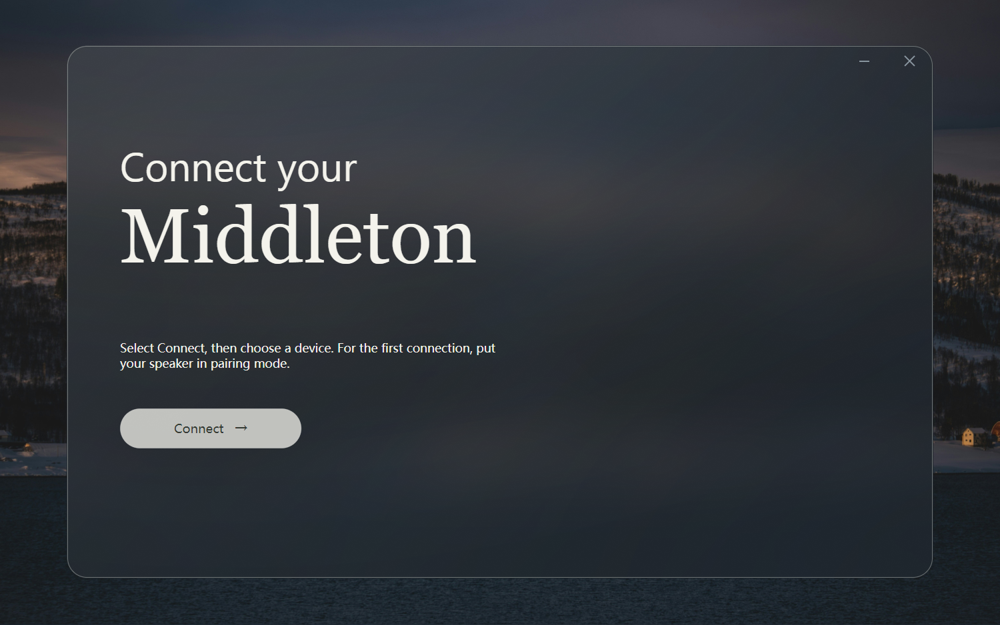
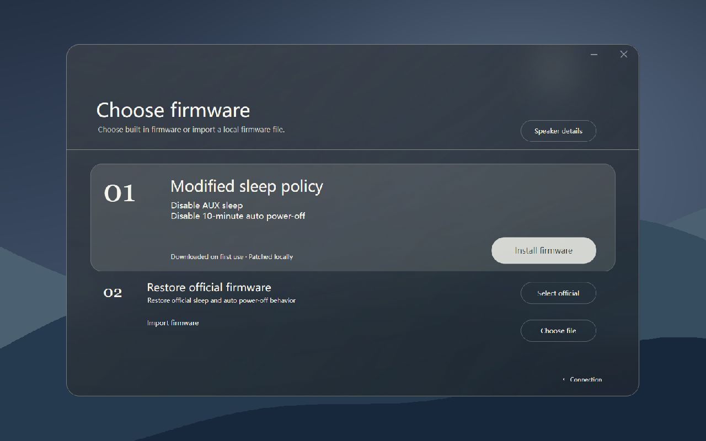
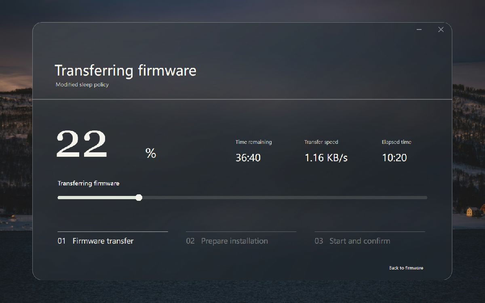
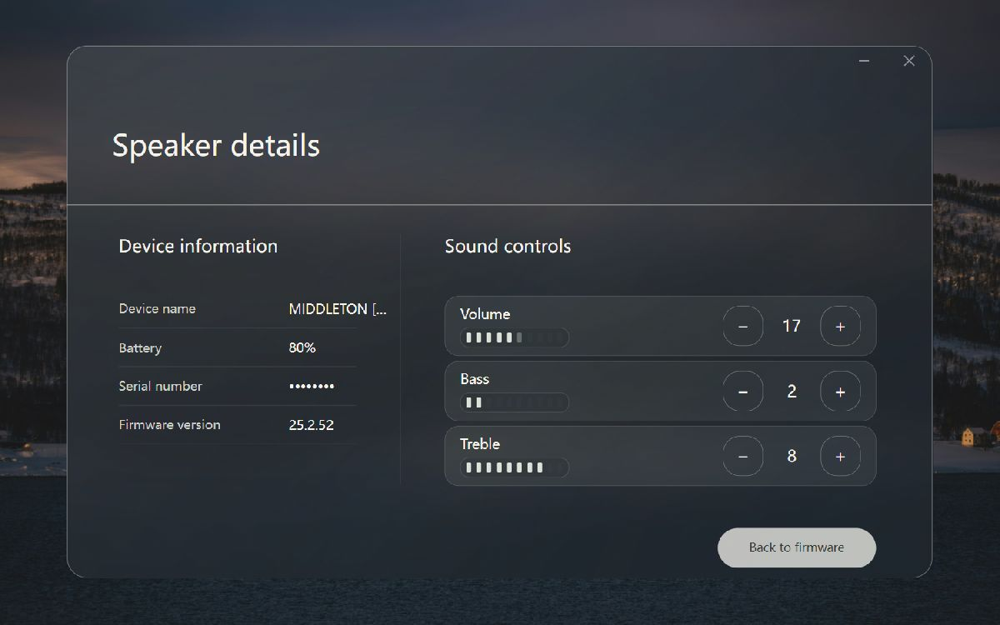
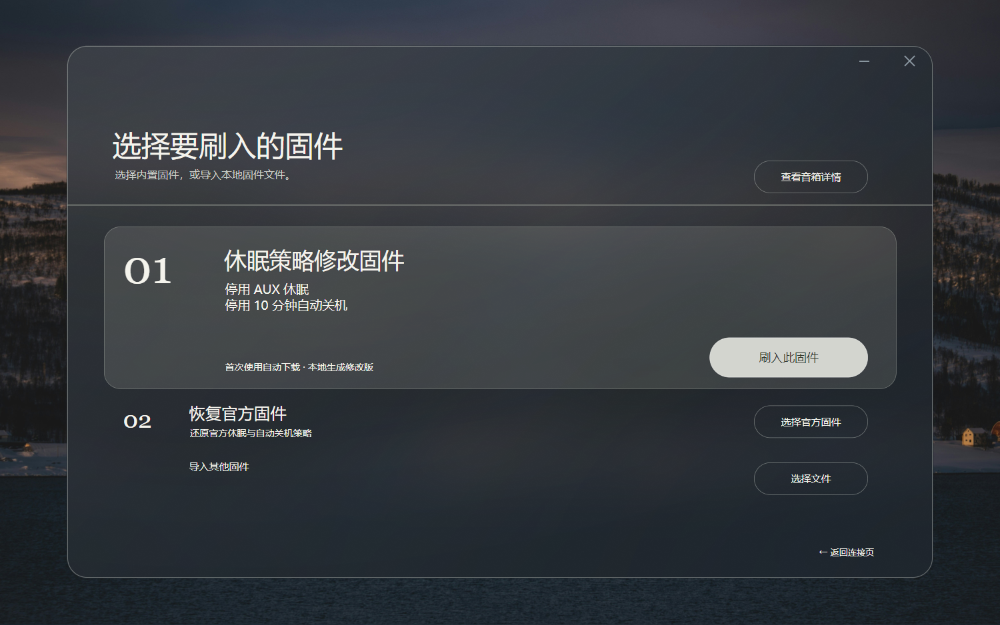
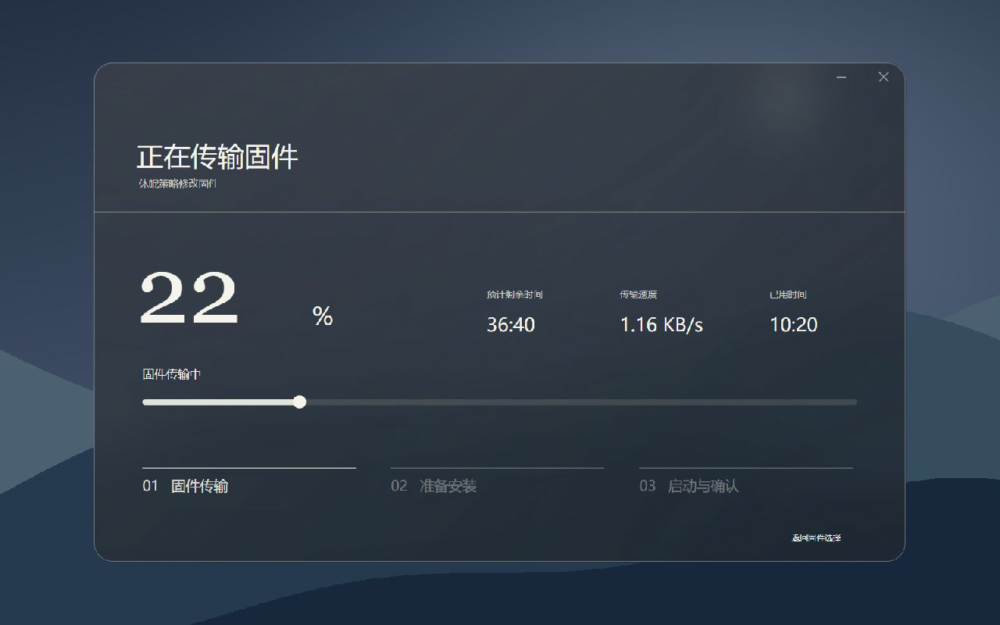
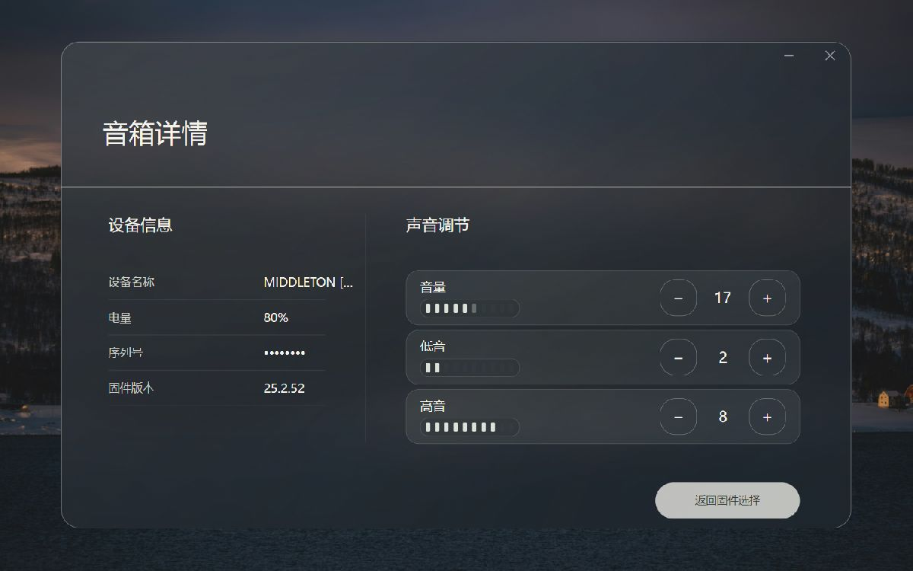

# Silver Moon

Flash modified Middleton firmware to disable AUX sleep and auto-off.

[Download](https://github.com/RougeNuage/silver-moon/releases) · [中文](#中文)

## Interface

Connect your speaker, choose firmware, and let the app handle transfer and installation. Then view device information and adjust volume and EQ.

<table width="700">
  <tr>
    <td width="50%" align="center"><a href="docs/images/en/start.webp"></a><br>Start</td>
    <td width="50%" align="center"><a href="docs/images/en/firmware.webp"></a><br>Choose firmware</td>
  </tr>
  <tr>
    <td width="50%" align="center"><a href="docs/images/en/transfer.webp"></a><br>Firmware transfer</td>
    <td width="50%" align="center"><a href="docs/images/en/details.webp"></a><br>Speaker details</td>
  </tr>
</table>

## Why Silver Moon

This project began with a very specific frustration: why can't users set the AUX sleep timer and the speaker's automatic shutdown timer to suit their own preferences? The manufacturer has already made these decisions and does not let users change them. Whether or not those settings suit you, you have no choice. My goal is to put those choices back in the hands of the people who own the device.

The patch currently available for automatic installation only disables AUX sleep and ten-minute auto-off; custom sleep durations are not yet implemented.

You can read the [third-party installation specification](docs/en/05-THIRD-PARTY-FIRMWARE-GUIDE.md), create firmware that meets the specification and your needs, and install it through the app's third-party firmware option.

## Features

- **Automated firmware preparation**: download the supported official firmware, verify its SHA-256, and generate the modified firmware locally.
- **Guided installation**: select a speaker and firmware, confirm installation, then let the app handle transfer, reconnection, resume, and completion checks.
- **Official firmware rollback**: restore the original sleep and auto-off behavior.
- **Everyday controls**: device information, volume, and EQ over Bluetooth LE.
- **Portable Windows app**: a single EXE; the UI currently supports only Chinese and English. Import of third-party firmware that meets the supported format is also available.

## Device support

I own only a first-generation Middleton, and hardware testing has been limited to that unit. Silver Moon currently supports only the first-generation Middleton. Middleton II and other models have not been tested and are not supported.

## How it works

1. **Connect**. Open `SilverMoon.exe`, turn on the speaker, and select its LE device. The app handles pairing and checks device compatibility.
2. **Choose**. Select modified firmware with AUX sleep and ten-minute auto-off disabled, or official firmware with the original behavior. The app downloads and verifies the supported base firmware and prepares the selected image automatically.
3. **Install**. Confirm installation. The app transfers the firmware, attempts reconnection after interruptions, and resumes according to the speaker's reported state.
4. **Finish**. After the upgrade and restart, the app reconnects and checks the device state before reporting completion.

No manual firmware patching or command-line flashing is needed for the built-in choices. The public EXE does not bundle firmware. When first preparing official or modified firmware, the app needs internet access to download the supported official firmware from the Marshall server and verify its SHA-256; modified firmware is then generated locally. A valid cached copy can be reused offline.

Windows 10 2004 / build 19041 or later, x64. `SHA256SUMS.txt` lets you verify the EXE download's integrity.

## Technical Documentation

Technical documents are available in [English](docs/en/README.md) and [Chinese](docs/zh-CN/README.md).

1. [Sleep logic and firmware patches](docs/en/01-FIRMWARE-PATCHES.md)
2. [Installation validation and staged RSA-PSS path](docs/en/02-UPGRADE-AND-VALIDATION.md)
3. [Bluetooth protocol and transfer performance](docs/en/03-BLUETOOTH-AND-WINDOWS.md)
4. [Firmware download and preparation](docs/en/04-OFFICIAL-FIRMWARE-PREPARATION.md)
5. [Third-party firmware format](docs/en/05-THIRD-PARTY-FIRMWARE-GUIDE.md)
6. [Persistent settings and research findings](docs/en/09-PERSISTENT-CONFIGURATION.md)
7. [Research findings and rejected approaches](docs/en/10-RESEARCH-FINDINGS.md)
8. [Evidence and reproducible verification](docs/en/08-EVIDENCE-AND-VERIFICATION.md)

Supports Middleton official 17.0.37 and project r2 (display version 25.2.52). The patch does not disable all power protections. Third-party format validation does not guarantee working firmware.

For modified firmware, the app uses a guarded staged-recovery path that avoids the normal full-image RSA-PSS footer-verification step. It does not remove the device's subsequent partition validation, trial boot or commit checks. Full-image transfers have measured about 45–50 minutes on the tested Windows setup; allow at least one hour. The conservative 45-byte chunks and sequential GATT/GAIA acknowledgements add round-trip overhead. See the [installation analysis](docs/en/02-UPGRADE-AND-VALIDATION.md) and [BLE performance notes](docs/en/03-BLUETOOTH-AND-WINDOWS.md).

## Build

Windows, PowerShell 7, and .NET SDK 10:

```powershell
pwsh -NoProfile -File ./tests/DesktopReadOnly/test.ps1 -WithoutFirmwareMaterials
pwsh -NoProfile -File ./src/SilverMoon/build.ps1 -WithoutBundledFirmware -CompressSingleFile -OutputDirectory publish-local
```

Tests requiring firmware materials are skipped in this mode. [Build guide](src/SilverMoon/RELEASE.md) · [Code guide](docs/en/06-CODE-REVIEWER-GUIDE.md) · [Localization](docs/en/07-UI-LOCALIZATION.md) · [Contributing](CONTRIBUTING.md) · [Security](SECURITY.md)

## License

Project-owned code is licensed under [GPL-3.0-only](LICENSE). Distributed derivative works must comply with its source-code and licensing requirements. Firmware and third-party dependencies retain their respective licenses. This project is not affiliated with or endorsed by Marshall.

---

# 中文

为 Middleton 刷入修改版固件，以去除官方固件中恼人的 AUX 频繁休眠和自动关机功能。

[下载](https://github.com/RougeNuage/silver-moon/releases) · [English](#silver-moon)

## 界面预览

连接音箱、选择固件，由软件自动完成传输与安装；随后可查看设备信息、调节音量与 EQ。

<table width="700">
  <tr>
    <td width="50%" align="center"><a href="docs/images/zh-CN/start.webp"></a><br>启动页</td>
    <td width="50%" align="center"><a href="docs/images/zh-CN/firmware.webp"></a><br>选择固件</td>
  </tr>
  <tr>
    <td width="50%" align="center"><a href="docs/images/zh-CN/transfer.webp"></a><br>传输固件</td>
    <td width="50%" align="center"><a href="docs/images/zh-CN/details.webp"></a><br>音箱详情</td>
  </tr>
</table>

## 项目初衷

项目最初来自一个很具体的不满：音箱为什么不能按照用户自己的喜好去设置 AUX 的休眠时间，去设置音箱的自动关机时间？所有这些都是厂商帮你设置好的，且不允许你去修改，不管你喜不喜欢这些设置，用户没有选择。我做的是把这些选择交还给拥有设备的人。

当前可自动刷入的补丁仅去除了 AUX 休眠和十分钟自动关机功能，暂未实现自定义休眠时间。

您可阅读[第三方安装规范](docs/zh-CN/05-THIRD-PARTY-FIRMWARE-GUIDE.md)，按照规范制作符合自己需求的固件，再通过软件的第三方固件通道刷入。

## 功能

- **自动准备固件**：下载支持的官方固件、校验 SHA-256，并在本地生成修改版。
- **引导式安装**：选择音箱与固件、确认安装后，由软件处理传输、断线重连、续传与完成检查。
- **回刷官方固件**：恢复原有的休眠与自动关机行为。
- **日常控制**：通过蓝牙 LE 查看设备信息、调节音量与 EQ。
- **便携桌面程序**：Windows 单文件 EXE，UI 当前仅支持中文和英文，也可导入符合规范的第三方固件。

## 设备支持范围

本人目前只有一台第一代 Middleton，实机测试仅在这台设备上进行。Silver Moon 当前仅支持第一代 Middleton；Middleton II 及其他型号尚未测试，也不在支持范围内。

## 使用流程

1. **连接音箱**。打开 `SilverMoon.exe`，开启音箱并选择其 LE 设备，软件处理配对并检查设备兼容性。
2. **选择固件**。选择已禁用 AUX 休眠和十分钟自动关机的修改版固件，或选择保留原有行为的官方固件。软件自动下载、校验支持的基础固件，并准备所选固件。
3. **确认安装**。软件开始传输；连接中断时尝试重连，根据音箱报告的状态恢复传输。
4. **等待完成**。升级与重启后，软件重新连接并检查设备状态，再报告安装完成。

使用内置选项时，不需要手动修改固件或通过命令行刷入。公开发布的 EXE 不内置固件，因此首次准备官方版或修改版固件时需要联网，从 Marshall 官方服务器下载支持的官方固件并校验 SHA-256；修改版随后在本地生成。已有有效缓存时可离线复用。

支持 Windows 10 2004 / build 19041 及以上的 x64 系统。`SHA256SUMS.txt` 用于检查 EXE 下载是否完整。

## 技术文档

提供[中文](docs/zh-CN/README.md)和[英文](docs/en/README.md)两套文档。

1. [休眠逻辑与固件修改](docs/zh-CN/01-FIRMWARE-PATCHES.md)
2. [安装校验与分阶段验签路径](docs/zh-CN/02-UPGRADE-AND-VALIDATION.md)
3. [蓝牙协议与传输性能](docs/zh-CN/03-BLUETOOTH-AND-WINDOWS.md)
4. [固件下载与准备](docs/zh-CN/04-OFFICIAL-FIRMWARE-PREPARATION.md)
5. [第三方固件规范](docs/zh-CN/05-THIRD-PARTY-FIRMWARE-GUIDE.md)
6. [持久化设置与研究结论](docs/zh-CN/09-PERSISTENT-CONFIGURATION.md)
7. [研究结论与已排除的方法](docs/zh-CN/10-RESEARCH-FINDINGS.md)
8. [证据与复现验证](docs/zh-CN/08-EVIDENCE-AND-VERIFICATION.md)

支持 Middleton 官方 17.0.37 与项目 r2（显示版本 25.2.52）。补丁不会关闭全部电源保护机制。第三方文件通过规范检查不代表固件功能正常。

修改版固件采用受约束的分区暂存/恢复路径，避开正常全包 RSA-PSS footer 验签步骤；设备后续的分区验证、试启动和提交检查仍会执行。Windows 实测全量传输约 45–50 分钟，建议至少预留一小时。当前保守的 45 字节分块及逐块等待 GATT/GAIA 确认会产生往返开销。详见[安装校验分析](docs/zh-CN/02-UPGRADE-AND-VALIDATION.md)和[蓝牙传输性能说明](docs/zh-CN/03-BLUETOOTH-AND-WINDOWS.md)。

## 构建

需要 Windows、PowerShell 7 和 .NET SDK 10，使用上方英文部分的构建命令。此模式跳过依赖固件素材的测试。

[构建指南](src/SilverMoon/RELEASE.md) · [代码导读](docs/zh-CN/06-CODE-REVIEWER-GUIDE.md) · [本地化](docs/zh-CN/07-UI-LOCALIZATION.md) · [参与贡献](CONTRIBUTING.md) · [安全问题](SECURITY.md)

## 许可证 License

项目自有代码采用 [GPL-3.0-only](LICENSE)。分发衍生作品时须遵守其源码提供及许可证要求。固件与第三方依赖保留各自许可证。本项目与 Marshall 无隶属或背书关系。
