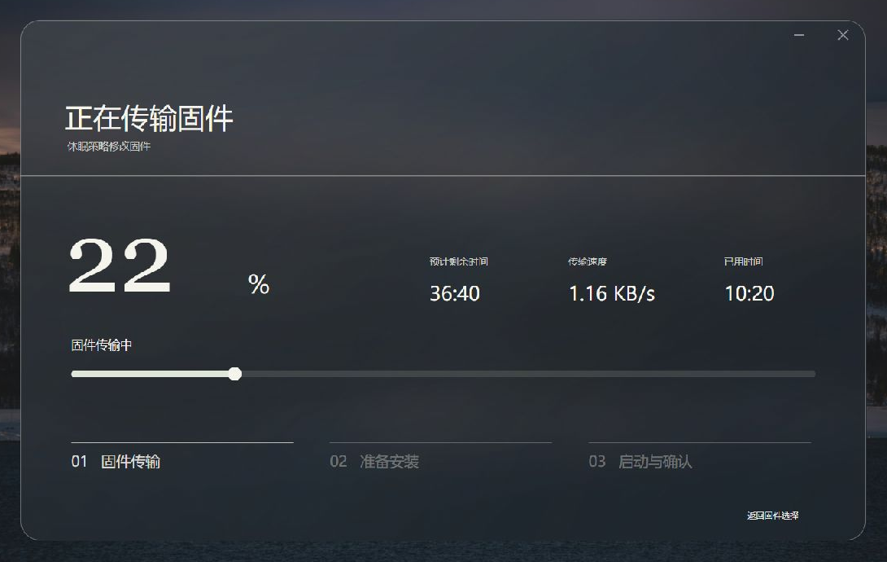
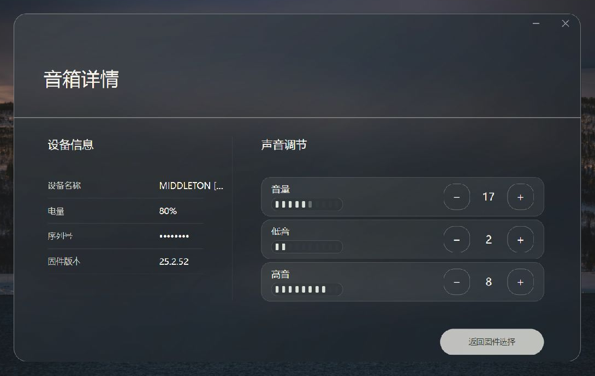

#  Silver Moon

为 Marshall Middleton 刷入修改版固件，去除 AUX 频繁休眠和自动关机功能。

[下载](https://github.com/RougeNuage/silver-moon/releases) · [English](README.md)

## 界面预览

连接音箱、选择固件，由软件自动完成传输与安装；随后可查看设备信息、调节音量与 EQ。

  
   

  
   

## 项目初衷

项目最初来自一个很具体的不满：音箱为什么不能按照用户自己的喜好去设置 AUX 的休眠时间，去设置音箱的自动关机时间？所有这些都是厂商帮你设置好的，且不允许你去修改，不管你喜不喜欢这些设置，用户没有选择。我做的是把这些选择交还给拥有设备的人。

当前可自动刷入的补丁仅去除了 AUX 休眠和十分钟自动关机功能，暂未实现自定义休眠时间。

您可阅读[第三方安装规范](docs/zh-CN/05-THIRD-PARTY-FIRMWARE-GUIDE.md)，按照规范制作符合自己需求的固件，再通过软件的第三方固件通道刷入。

## 功能

- **自动准备固件**：下载支持的官方固件、校验 SHA-256，并在本地生成修改版。
- **引导式安装**：选择音箱与固件、确认安装后，由软件处理传输、断线重连、续传与完成检查。
- **回刷官方固件**：恢复原有的休眠与自动关机行为。
- **日常控制**：通过蓝牙 LE 查看设备信息、调节音量与 EQ。
- **便携桌面程序**：Windows 单文件 EXE，UI 当前仅支持中文和英文，也可导入符合规范的第三方固件。

## 设备支持范围

本人目前只有一台第一代 Middleton，实机测试仅在这台设备上进行。Silver Moon 当前仅支持第一代 Middleton；Middleton II 及其他型号尚未测试，也不在支持范围内。

## 常见问题

**能否关闭 Marshall Middleton 的 AUX 休眠和自动关机？**

可以。Silver Moon 为第一代 Middleton 安装修改版固件，禁用 AUX 休眠与十分钟闲置自动关机，解决通过 AUX 当电脑音箱使用时不希望它休眠或自动关机的问题，无需后台持续播放音频来保持唤醒。

这类行为也常被称为自动待机或闲置关机。补丁并不解决所有原因造成的声音中断或异常关机，详见[休眠逻辑与固件修改](docs/zh-CN/01-FIRMWARE-PATCHES.md)。

## 使用流程

1. **连接音箱**。打开 `SilverMoon.exe`，开启音箱并选择其 LE 设备，软件处理配对并检查设备兼容性。
2. **选择固件**。选择已禁用 AUX 休眠和十分钟自动关机的修改版固件，或选择保留原有行为的官方固件。软件自动下载、校验支持的基础固件，并准备所选固件。
3. **确认安装**。软件开始传输；连接中断时尝试重连，根据音箱报告的状态恢复传输。
4. **等待完成**。升级与重启后，软件重新连接并检查设备状态，再报告安装完成。

使用内置选项时，不需要手动修改固件或通过命令行刷入。公开发布的 EXE 不内置固件，因此首次准备官方版或修改版固件时需要联网，从 Marshall 官方服务器下载支持的官方固件并校验 SHA-256；修改版随后在本地生成。已有有效缓存时可离线复用。

支持 Windows 10 2004 / build 19041 及以上的 x64 系统。`SHA256SUMS.txt` 用于检查 EXE 下载是否完整。

## 技术文档

提供[中文](docs/zh-CN/README.md)和[英文](docs/en/README.md)两套文档。

1. [休眠逻辑与固件修改](docs/zh-CN/01-FIRMWARE-PATCHES.md)
2. [安装校验与分阶段验签路径](docs/zh-CN/02-UPGRADE-AND-VALIDATION.md)
3. [蓝牙协议与传输性能](docs/zh-CN/03-BLUETOOTH-AND-WINDOWS.md)
4. [固件下载与准备](docs/zh-CN/04-OFFICIAL-FIRMWARE-PREPARATION.md)
5. [第三方固件规范](docs/zh-CN/05-THIRD-PARTY-FIRMWARE-GUIDE.md)
6. [持久化设置与研究结论](docs/zh-CN/09-PERSISTENT-CONFIGURATION.md)
7. [研究结论与已排除的方法](docs/zh-CN/10-RESEARCH-FINDINGS.md)
8. [证据与复现验证](docs/zh-CN/08-EVIDENCE-AND-VERIFICATION.md)

支持 Middleton 官方 17.0.37 与项目 r2（显示版本 25.2.52）。补丁不会关闭全部电源保护机制。第三方文件通过规范检查不代表固件功能正常。

修改版固件采用受约束的分区暂存/恢复路径，避开正常全包 RSA-PSS footer 验签步骤；设备后续的分区验证、试启动和提交检查仍会执行。Windows 实测全量传输约 45–50 分钟，建议至少预留一小时。当前保守的 45 字节分块及逐块等待 GATT/GAIA 确认会产生往返开销。详见[安装校验分析](docs/zh-CN/02-UPGRADE-AND-VALIDATION.md)和[蓝牙传输性能说明](docs/zh-CN/03-BLUETOOTH-AND-WINDOWS.md)。

## 构建

需要 Windows、PowerShell 7 和 .NET SDK 10，使用 [英文 README](README.md#build) 中的构建命令。此模式跳过依赖固件素材的测试。

[构建指南](src/SilverMoon/RELEASE.md) · [代码导读](docs/zh-CN/06-CODE-REVIEWER-GUIDE.md) · [本地化](docs/zh-CN/07-UI-LOCALIZATION.md) · [参与贡献](CONTRIBUTING.md) · [安全问题](SECURITY.md)

## 许可证 License

项目自有代码采用 [GPL-3.0-only](LICENSE)。分发衍生作品时须遵守其源码提供及许可证要求。固件与第三方依赖保留各自许可证。本项目与 Marshall 无隶属或背书关系。
